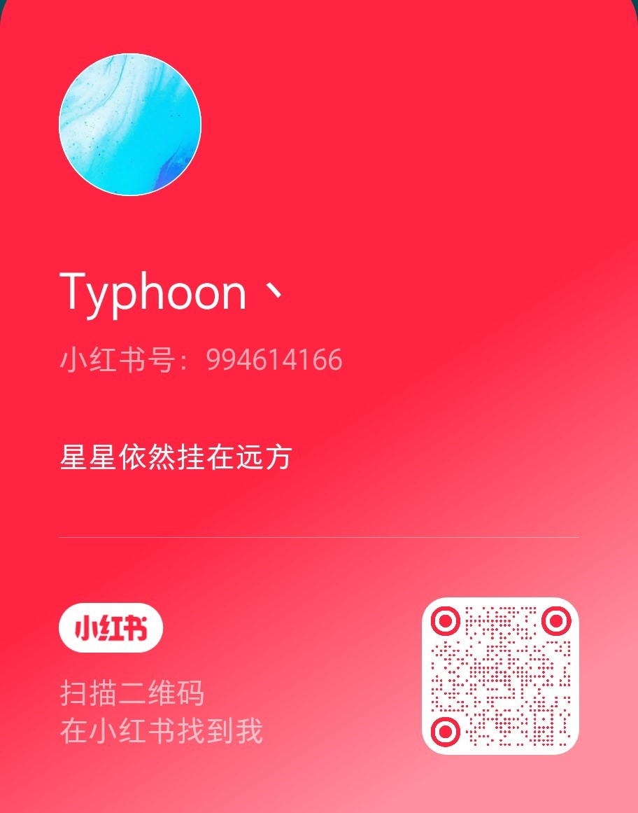
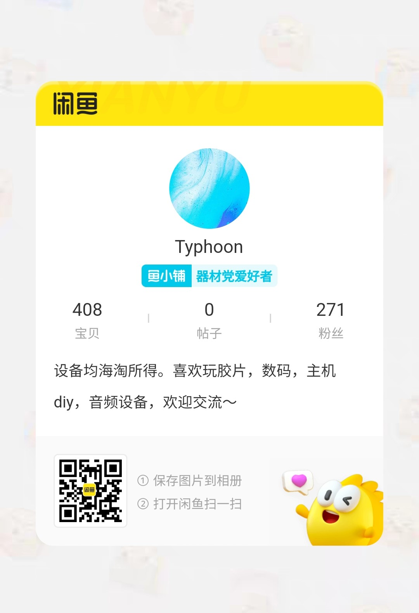

# film-scan_epson

本仓库主要为 **爱普生（Epson）等平板扫描仪** 胶片扫描玩家准备的，**使用**教程、**调试**教程 与 **参考资料** 集合。

针对在 135 / 120 / 4×5 / 8×10 胶片扫描中的校准焦平面、片夹、垫高、除尘、防牛顿环等实操痛点，把验证过的流程沉淀成可复用的 WorkBuddy skill、图文资料，当然其他agent也可使用。后续会持续补充更多 skill。

## 目录

- [参考资料](#参考资料)
- [扫描仪调试](#扫描仪调试)
- [超薄片夹](#超薄片夹)
- [胶片除尘设备](#胶片除尘设备)
- [收录的 skill](#收录的skill)
- [防牛顿处理](#防牛顿处理)
- [购买建议](#购买建议)
- [许可证](#许可证)

## 参考资料

- [爱普生、佳能 平板扫描仪性能参数表](scanner-material/平板扫描仪性能参数表.md)
- **epson scan 官方扫描软件图文教程：**
- [基础操作流程](scanner-material/基础操作流程.webp)
- [英语客户端 / 中文界面对照](scanner-material/英语-客户端-中文对照.webp)

## 扫描仪调试

1、如果您希望为扫描仪**更换面板玻璃**，提升扫描效果。

爱普生V700/V750/V850 可以参考【Epson V700更换原装台面玻璃教程 - 扁舟子】[xhslink.cn/o/6Fq4ngD6iwg](https://xhslink.cn/o/6Fq4ngD6iwg)   致谢@扁舟子

爱普生4990等老机型更换玻璃更麻烦点，调焦教程之前色影无忌论坛有，现在论坛关闭了。**非常不建议直接拆镜头调整**！

佳能未用过，目前倾向于9950F，待购入补充。

2、如果您扫描仪已经更换了面板玻璃，想要调焦至更高的精度。
爱普生V700/V750/V850 可以参考【EPSON V700调焦教程 - 扁舟子】[xhslink.cn/o/96bLwkENwWg](https://xhslink.cn/o/96bLwkENwWg)    致谢@扁舟子

**在校准过程中可以使用本仓库 film-scan-rank 这个 skill**，只用底片就可校准，文件夹中有图文教程。

3、如果您使用原厂片夹，希望**垫高原厂片夹**，接近扫描焦平面，提升扫描精度。可以使用 [tilt-focus-sweep](tilt-focus-sweep/) 这个skill，文件夹中有图文教程[`tilt-focus-sweep/计算垫高教程.md`](tilt-focus-sweep/计算垫高教程.md)。

4、如果您扫描仪想要达到最佳扫描效果，可以考虑 更换面板玻璃+(调焦+超薄片夹)+除尘处理，按顺序升级

**更换玻璃过程中一定要注意防护！更换玻璃过程中一定要注意防护！**

本人也提供相关改造升级服务，出售超薄片夹 和 改装校准完毕的扫描仪，每台都留存数字档案，可联系。

提供远程安装驱动，日版机型也可以实现中文客户端，包教包会。微信订购98折，一对一服务。

<a href="xhs.webp"></a>        <a href="wx.webp"></a>     <a href="xy.webp"></a>

## 超薄片夹

本人开发的超薄片夹适用于已改装面板并校准焦平面的扫描仪。与原厂片夹相比：

▎装载更快 —— 一盖一压就位，135 一次 4 条、120 一次 2 条

▎压片更平 —— 单层厚度接近底片，配防牛顿玻璃压平，弱静电自然吸附、抑制卷曲

▎齿孔多样 —— 全齿孔 / 小齿孔 / 无齿孔随心选，原生边字不用后期模拟

▎微调简单 —— 戴手套轻推微调毫不费力，边看边调，轨道精度0.1mm更容易装载到位

▎定位准确 —— 销钉 + 靠边对齐双重定位，防呆设计，裁框横平竖直

设计思路：

以原厂片夹规格尺寸为基准做原始设计，经多轮打样调试后达到稳定可靠的效果

片夹采用超薄、绝缘的高分子材料，厚度近乎与底片一致，能最大程度将底片压平

表面磨砂处理，尽可能减少反光对扫描的干扰

开孔精准、边缘绝缘光滑，装载方便，使用简单高效

更多相关图像、**使用教程详见** [film-holder-material/片夹使用教程/](film-holder-material/片夹使用教程/)、**资料说明详见** [film-holder-material/](film-holder-material/)

**可调整高度片夹**有方案，开发中

## 胶片除尘设备

先准备空气净化器，20平以内房间，小米米家4lite即可。准备扫描前，室内尽量密闭，衣物用粘毛器滚一滚，尽量不要活动，开启空气净化器净化20分钟。清洁扫描仪面板玻璃，气吹吹掉底片浮尘，然后开始扫描。

以上条件满足后，可用胶片除尘设备代替气吹。再升级就是离子清洁器，对底片做除静电+收集灰尘的处理，待开发。

## 收录的skill

#### [tilt-focus-sweep](tilt-focus-sweep/) —— 利用调焦卡计算片夹垫高高度

利用调焦卡（135或120规格）长条扫描图，找出扫描仪焦平面落在长条上的最佳位置，算出片夹四个支脚应统一垫起的高度，消除因片夹与玻璃不平行导致的离焦模糊。支持**两遍精测法**，把定位精度提升到约 0.027mm/份。

教程详见子目录 [`tilt-focus-sweep/计算垫高教程.md`](tilt-focus-sweep/计算垫高教程.md)。

#### [film-scan-rank](film-scan-rank/) —— 通过多次扫描 结果排名 定位焦平面

利用每次调焦后底片扫描图像，通过脚本计算得分，排行对比得出扫描效果最佳的一次调整，按此次调整固定好面板即可。支持 JPG（8bit，0.70锐+0.15色+0.15跨）与 TIFF（16bit，0.85锐+0.15色）两条独立管线，各有全量与加测入口；严格同帧对齐、只在原图像素上算指标。

教程详见子目录 [`film-scan-rank/README.md`](film-scan-rank/README.md)。

#### [epson_scan-auto](epson_scan-auto/) —— epson scan官方软件全自动执行扫描

超薄片夹优化了底片装载效率，而这个skill从软件层解放双手，告别预览等待。自动控制经典 EPSON Scan 3.9 走完机型确定→专业模式设置→配置→文件保存→预览→扫描→落盘全流程。三套流程方案用 JSON 保存、命令行切换：`rank`（48bit TIFF 排名）/ `jpg_social`（JPEG 社媒）/ `tiff_post`（48bit TIFF 后期）。全程后台消息级不抢鼠标。

教程详见子目录 [`epson_scan-auto/README.md`](epson_scan-auto/README.md)。

#### [sprocket-glare-fix](sprocket-glare-fix/) —— 扫描图像齿孔眩光改善

超薄片夹在全齿孔扫描时，不可避免的会产生齿孔附近眩光，这是扫描仪本身光学结构就存在的问题，与片夹、扫描软件、扫描方式等无关。

教程详见子目录 [`sprocket-glare-fix/README.md`](sprocket-glare-fix/README.md)。

#### [tiff-to-exr](tiff-to-exr/)—— epson scan 扫描的tiff文件线性化 适用于达芬奇去色罩流程

详见子目录 [`tiff-to-exr/README.md`](tiff-to-exr/README.md)。

#### 如何使用这些 skill

- 在Ai对话中输入：

```
安装 https://github.com/Typhoon-line/film-scan_epson/tree/main/tilt-focus-sweep
```

```
安装 https://github.com/Typhoon-line/film-scan_epson/tree/main/film-scan-rank
```

```
安装 https://github.com/Typhoon-line/film-scan_epson/tree/main/epson_scan-auto
```

```
安装 https://github.com/Typhoon-line/film-scan_epson/tree/main/sprocket-glare-fix
```

## 防牛顿处理

在底片放置过程中，从下至上应是 扫描仪玻璃-底片粗糙面-底片光滑面-片夹-防牛顿玻璃粗糙面，严格以上顺序会较小概率牛顿环。

当仍有牛顿环产生时，检查牛顿环对应底片位置， 扫描仪玻璃-底片粗糙面 之间是否有颗粒物，清洁后再次扫描牛顿环应该就消失了。

## 购买建议

不想负片手动去色罩、觉得翻拍准备工作麻烦的，可以试试平板扫描仪，135至8*10大画幅一步到位了，还多个红外除尘

一般扫描直出可以发社媒了，还是建议学一下调色，capture one/Lightroom，去色罩和调色教程一搜就很多

低预算爱普生4990也可以，建议高一点V700、V750。本人自用V750，V850嘛看个人了

## 许可证

各 skill 以其子目录内的 `LICENSE` 为准（脚本多为 MIT）；操作示意图版权归原作者所有，转载使用前请取得授权
