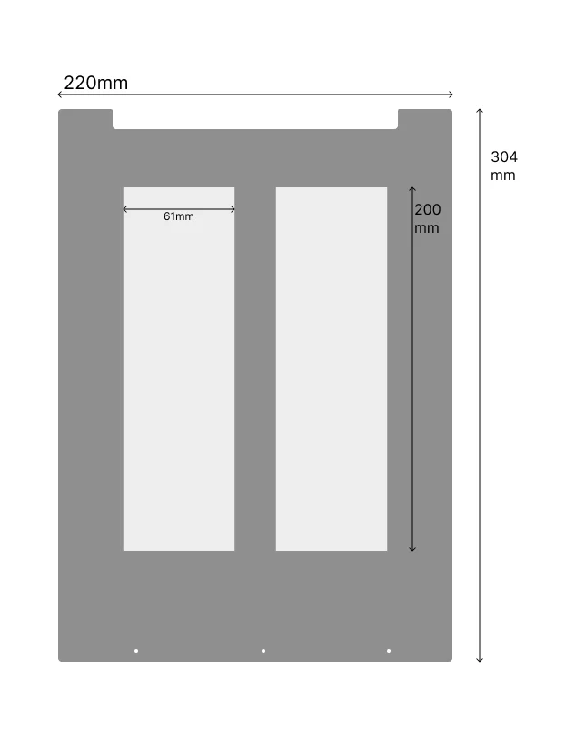
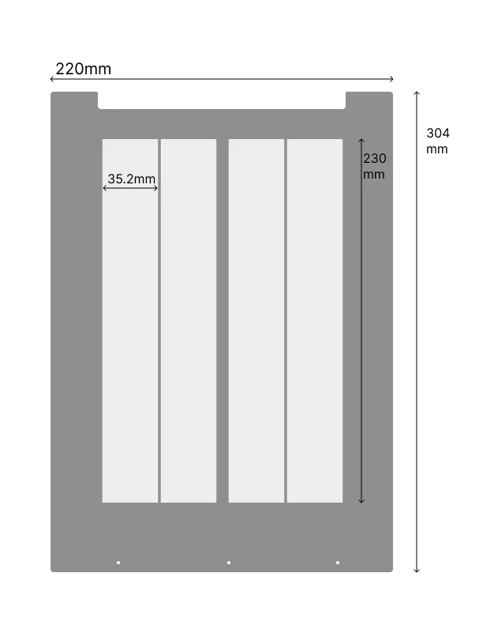
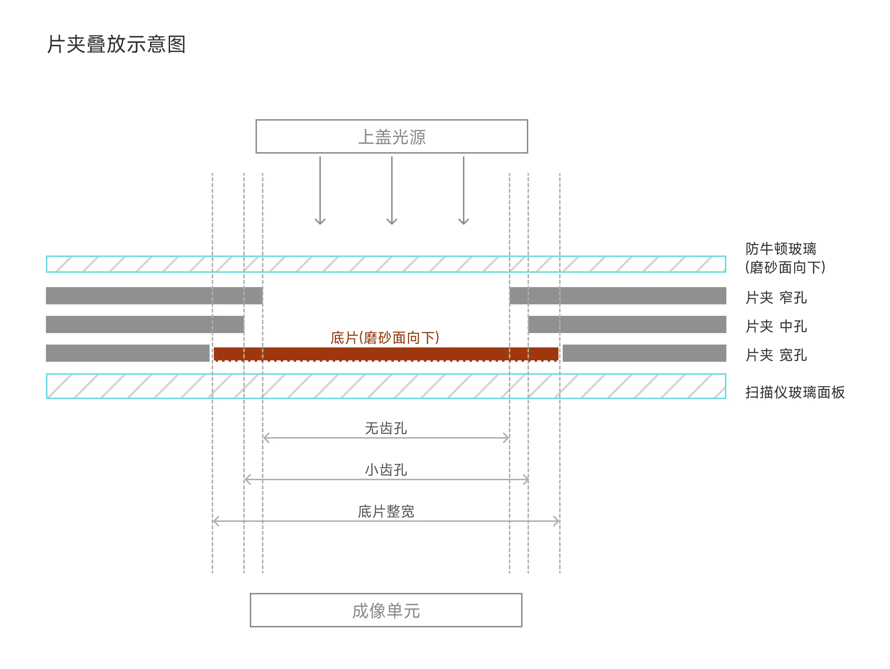
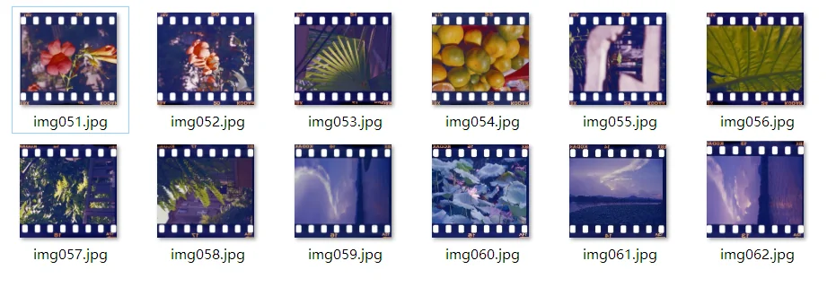

# 片夹相关资料（film-holder-material）

本目录收录超薄片夹的设计稿、叠放示意图、epson scan 预览与扫描成片效果，供选型与改装参考。

## 设计稿

<table>
<tr>
<td></td>
<td></td>
</tr>
<tr><td align="center">120 片夹设计稿</td><td align="center">135 片夹设计稿</td></tr>
</table>

## 片夹叠放示意图

## epson scan 预览（齿孔对比）

<table>
<tr>
<td></td>
<td></td>
<td></td>
</tr>
<tr><td align="center">全齿孔</td><td align="center">小齿孔</td><td align="center">无齿孔</td></tr>
</table>

## 扫描成片预览

