# 片夹相关资料（film-holder-material）

本目录收录超薄片夹的设计稿、扫描成片预览和片夹图文详情，适用于已改装面板、校准过焦平面的扫描仪。需配合防牛顿玻璃搭配使用。另外可调高度片夹也在开发中。

## 设计稿

<table>  
<tr>  
<td>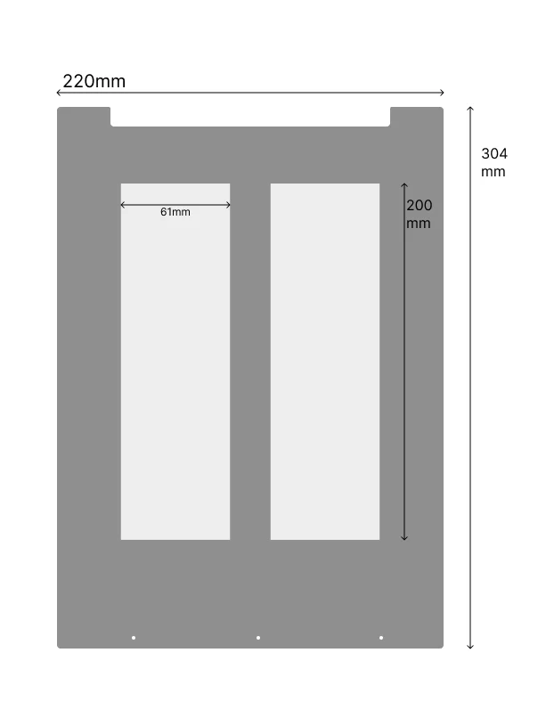</td>  
<td>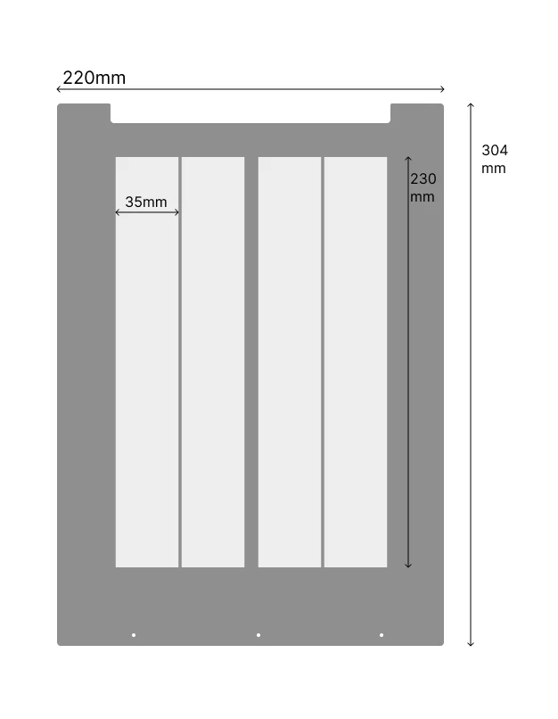</td>  
</tr>  
<tr><td align="center">120 片夹设计稿</td><td align="center">135 片夹设计稿</td></tr>  
</table>

## 扫描成片预览

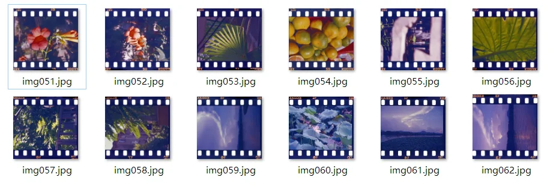

## 片夹详情

<table>
<tr><td>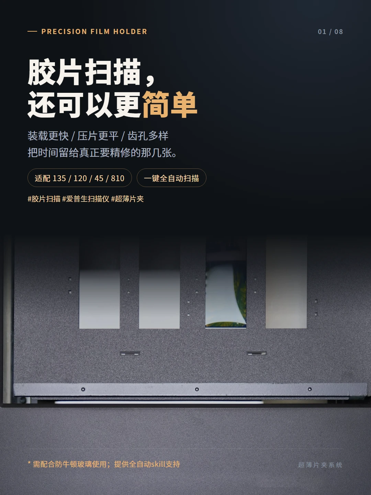</td></tr>
<tr><td align="center">片夹详情1</td></tr>
<tr><td></td></tr>
<tr><td align="center">片夹详情2</td></tr>
<tr><td>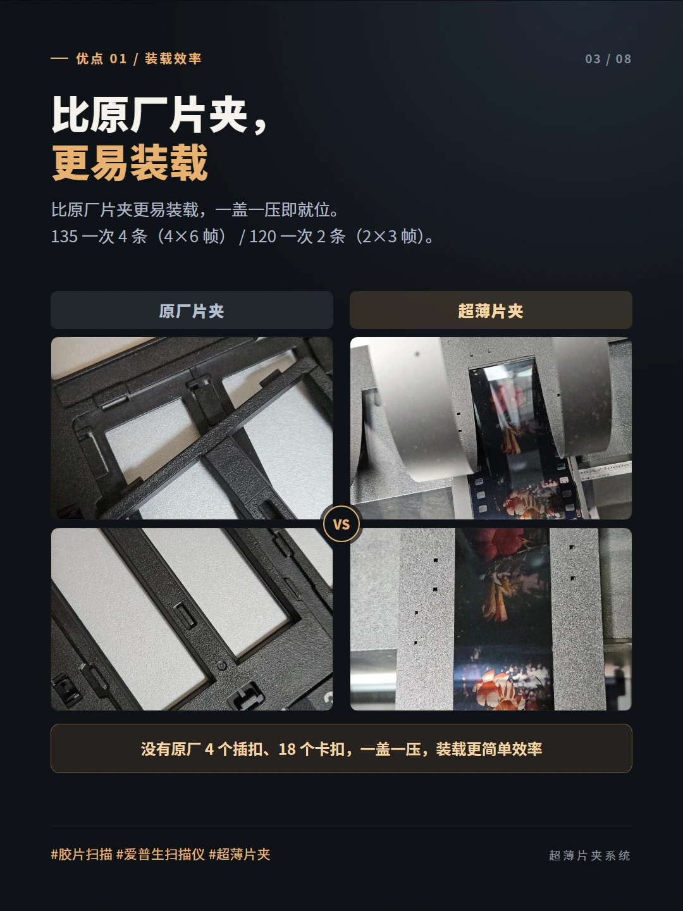</td></tr>
<tr><td align="center">片夹详情3</td></tr>
<tr><td>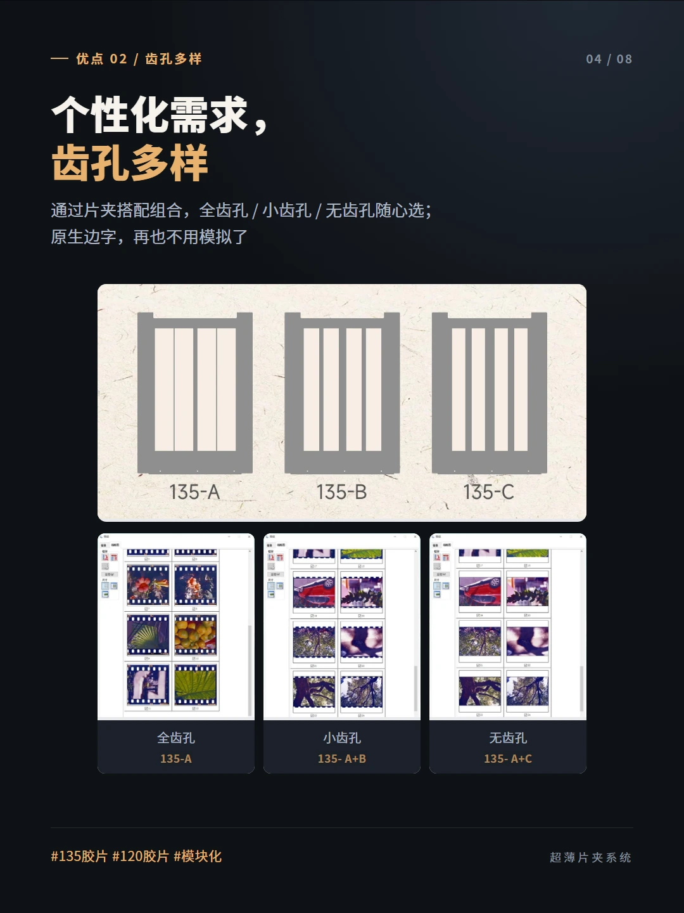</td></tr>
<tr><td align="center">片夹详情4</td></tr>
<tr><td>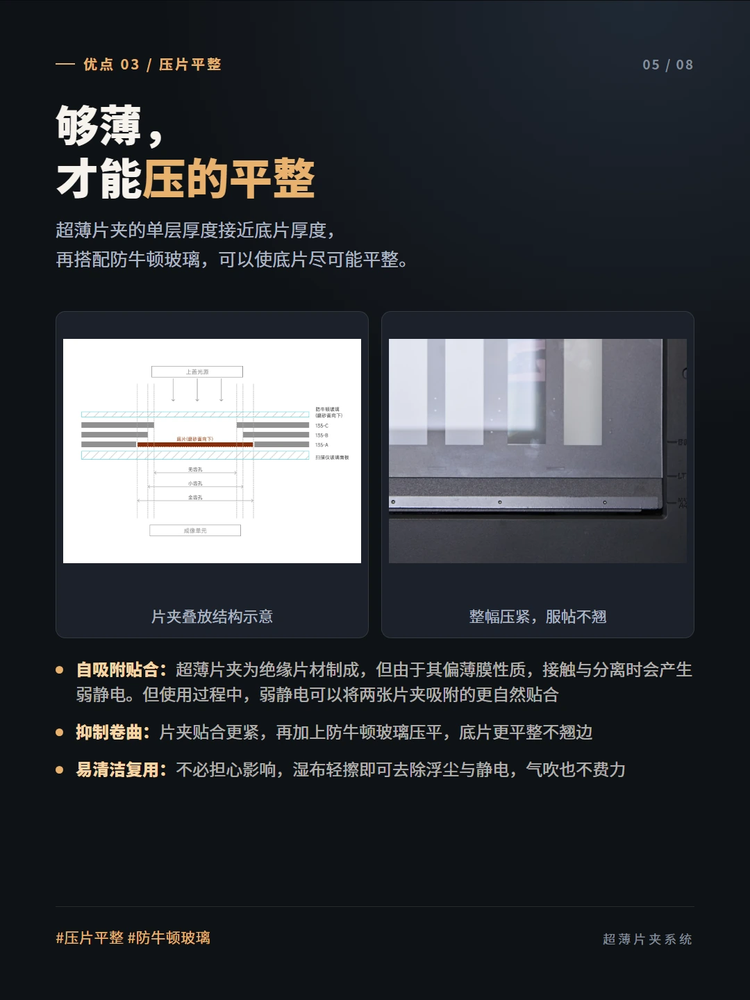</td></tr>
<tr><td align="center">片夹详情5</td></tr>
<tr><td>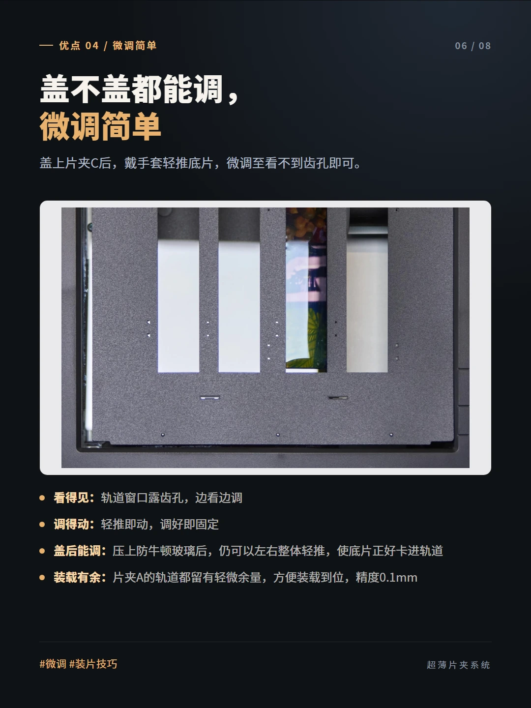</td></tr>
<tr><td align="center">片夹详情6</td></tr>
<tr><td>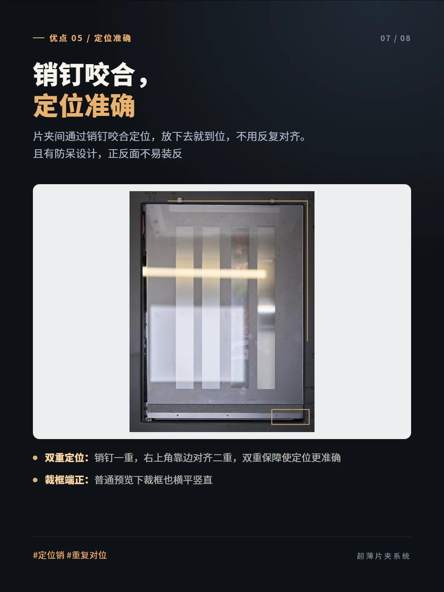</td></tr>
<tr><td align="center">片夹详情7</td></tr>
<tr><td>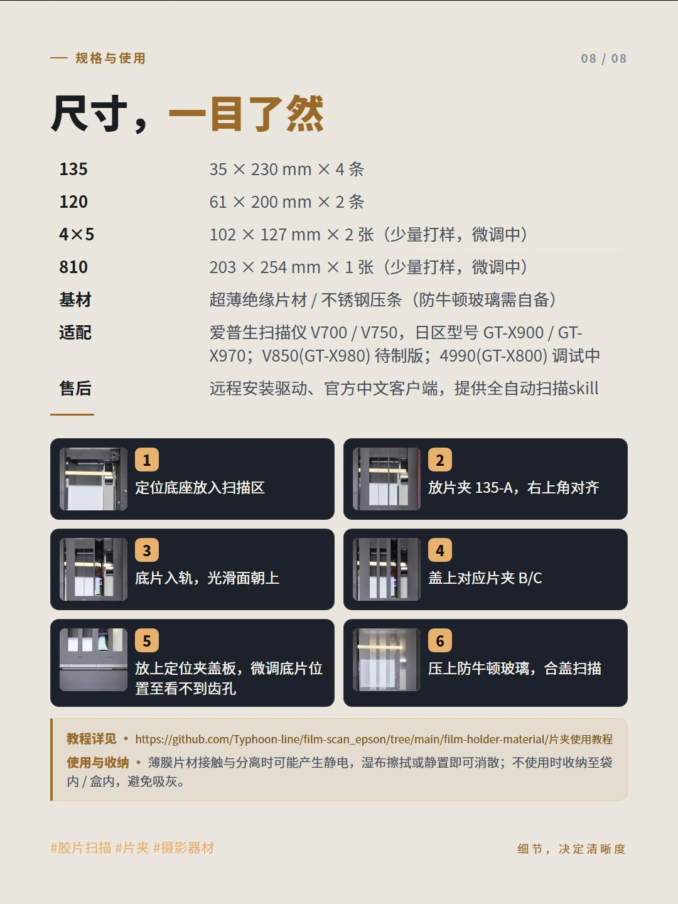</td></tr>
<tr><td align="center">片夹详情8</td></tr>
</table>

## 版本配置

<table>
<tr>
<td>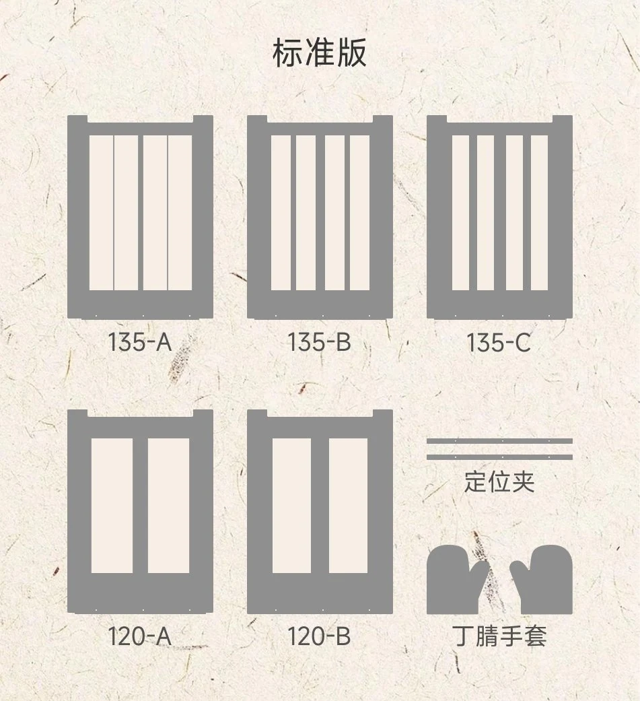</td>
<td>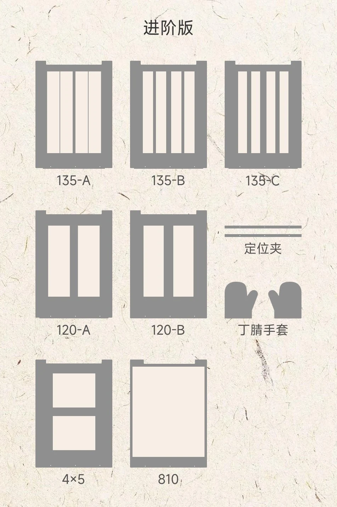</td>
</tr>
<tr><td align="center">标准版</td><td align="center">进阶版</td></tr>
</table>
