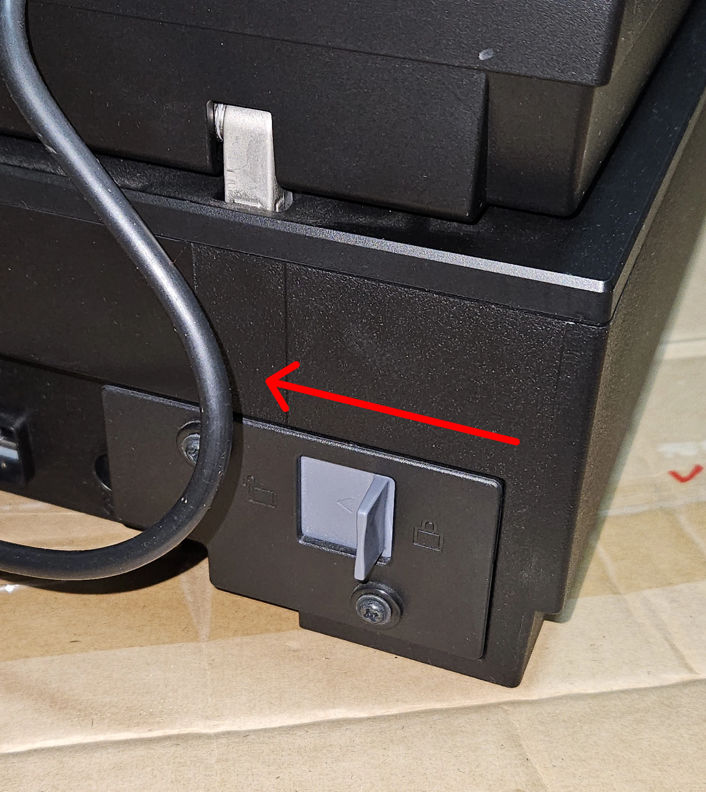
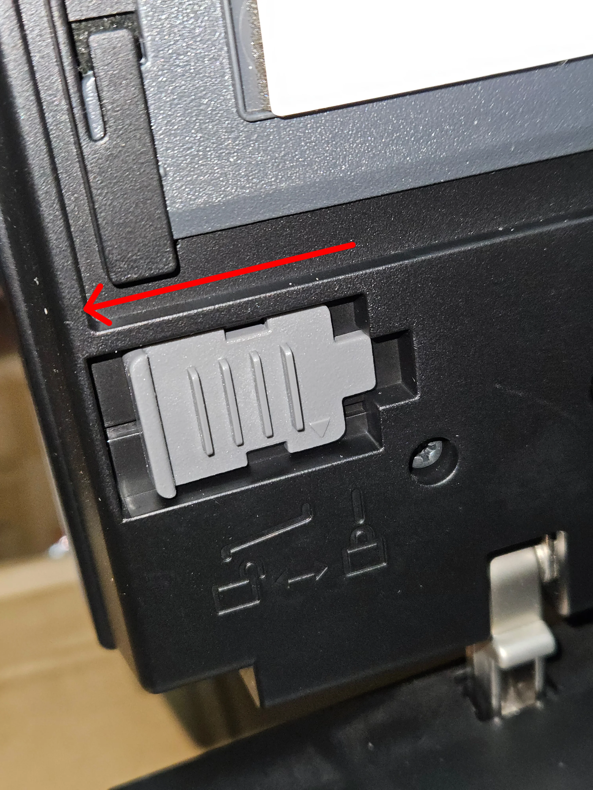
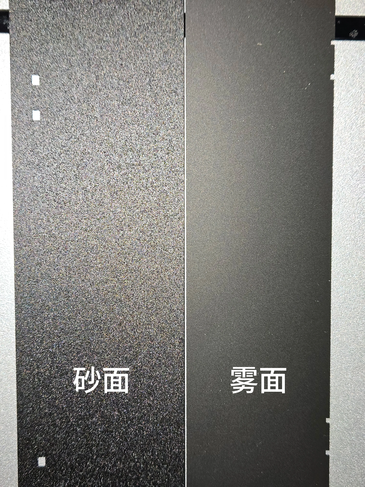
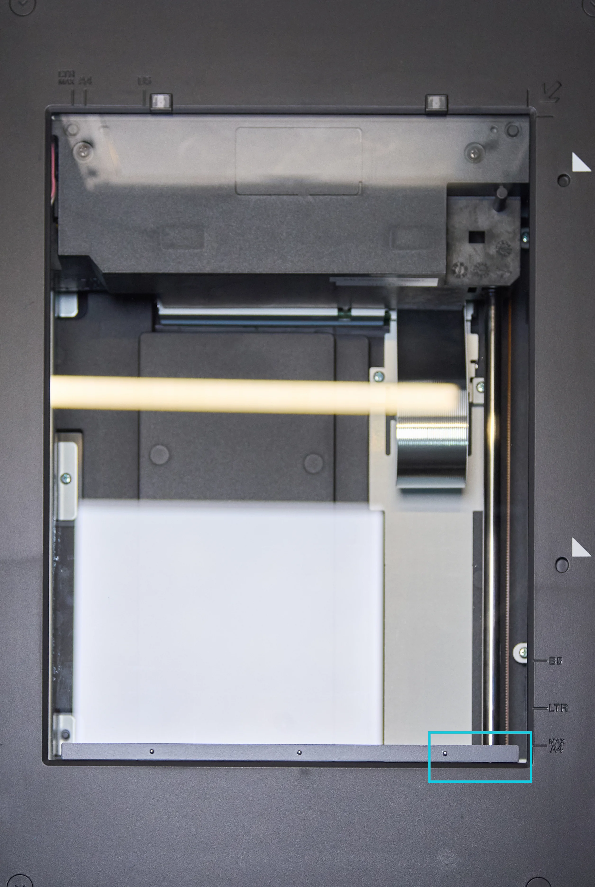
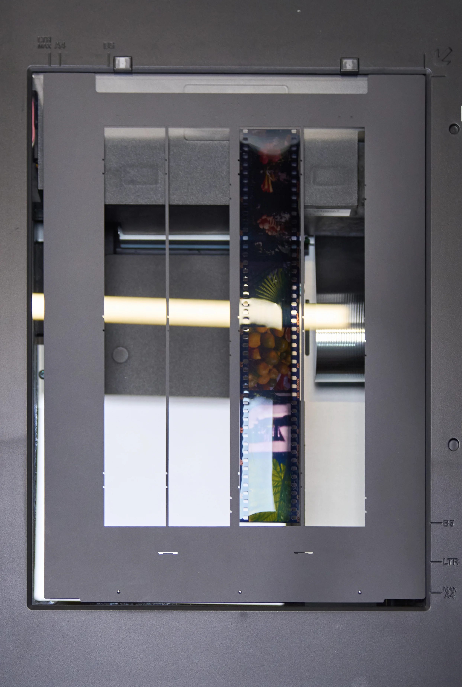
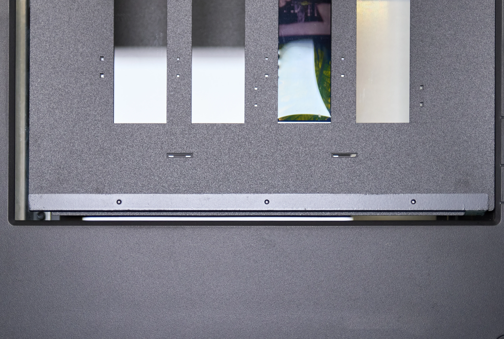

# 片**夹使用教程**

**准备工作： 从袋中取出片夹时动作一定要轻柔，避免扯坏变形；扫描机机身锁、上盖锁要拨至解锁状态**

1、抬起扫描仪上盖，将定位夹底座如图放置于扫描区，注意 销钉至端点距离短的在右侧

2、如图放置片夹135-A，注意 右上角对齐、雾面朝上

3、放置底片至轨道， 注意 光滑面朝上

4、覆盖片夹135-B/135-C，销钉对齐

5、盖上定位夹盖板，戴手套微调底片位置至看不到齿孔

6、盖上防牛顿玻璃，磨砂面朝下；合上扫描仪上盖，开机，电脑打开epson scan执行扫描

