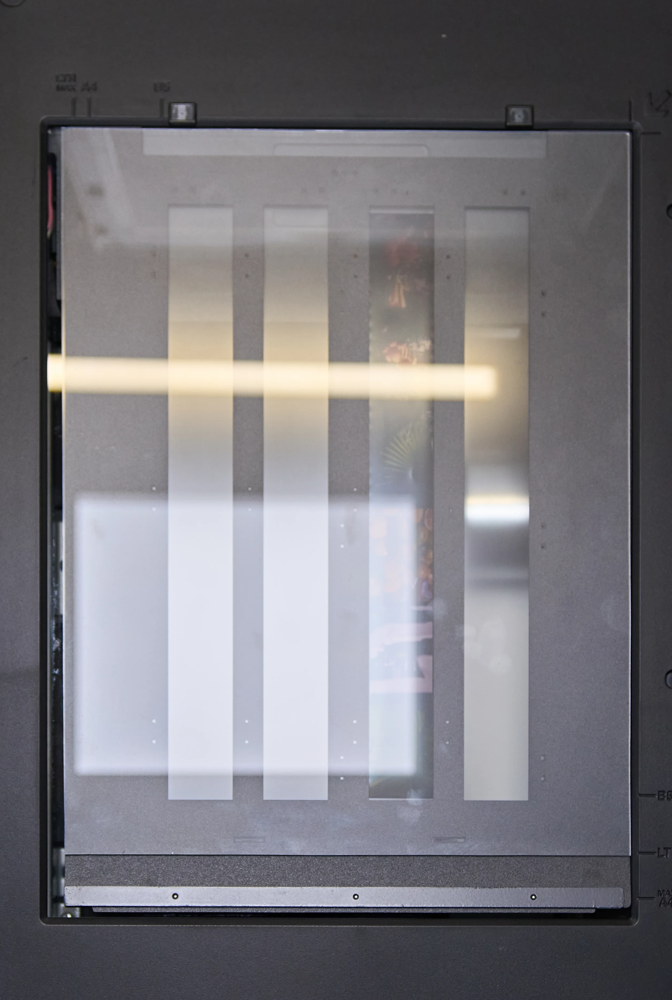

# 片**夹使用教程**

## 准备工作：从袋中取出片夹时动作一定要轻柔，避免扯坏变形；扫描机机身锁、上盖锁要拨至解锁状态

  

以下为135无齿孔扫描教程，120无齿孔同理；全齿孔只放片夹A即可；45、810默认带边字，不需要边字裁框即可  
需注意：带齿孔不要开红外除尘；全齿孔只放中间两轨
------------------------

1、抬起扫描仪上盖，将定位夹底座如图放置于扫描区，注意 销钉至端点距离短的在右侧

## 2、如图放置片夹135-A，注意 右上角对齐、雾面朝上

## 3、放置底片至轨道， 注意 光滑面朝上

## 4、覆盖片夹135-C（无齿孔盖133-C / 小齿孔盖135-B / 全齿孔直接盖防牛顿玻璃），销钉对齐

## 5、盖上定位夹盖板，戴手套微调底片位置至看不到齿孔

## 6、盖上防牛顿玻璃，磨砂面朝下；合上扫描仪上盖，开机，电脑打开epson scan执行扫描

