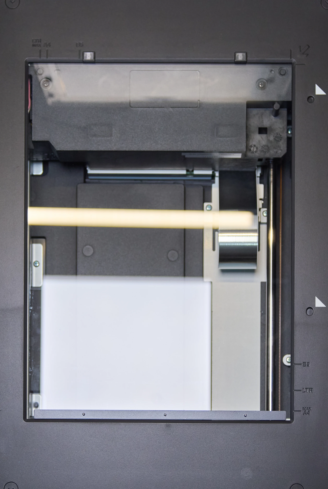
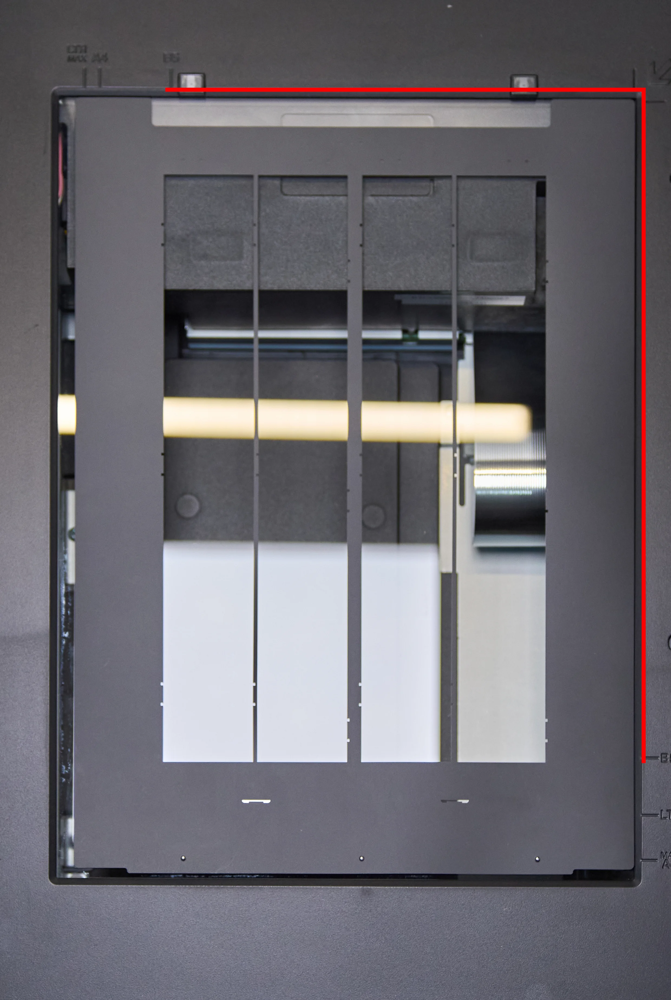
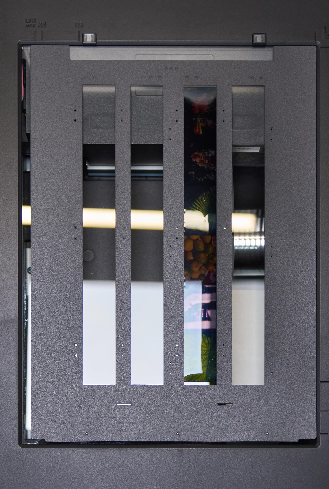

# 片夹使用教程

本目录以实拍图记录平板扫描仪（爱普生 V700/V750/V850 等）面板玻璃与机身锁扣、玻璃表面（砂面/雾面）的辨识要点，供拆装与日常使用参考。图片均以 WebP 存储，点击可查看大图。

## 面板与机身内部结构

<table>
<tr>
<td align="center"> 图1</td>
<td align="center"> 图2</td>
</tr>
<tr>
<td align="center"> 图3</td>
<td align="center"> 图4</td>
</tr>
<tr>
<td align="center"> 图5</td>
<td align="center"> 图6</td>
</tr>
</table>

## 锁扣位置

<table>
<tr>
<td align="center"> 上盖锁</td>
<td align="center"> 机身锁</td>
</tr>
</table>

## 玻璃表面：砂面 / 雾面

两块玻璃表面处理不同，装配时需注意朝向。

